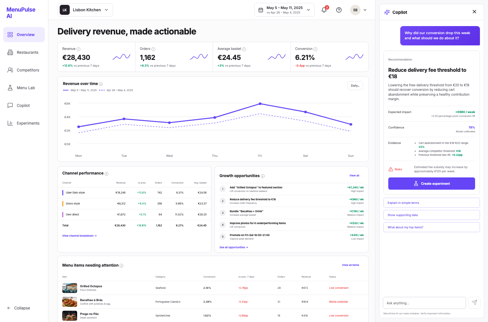

# MenuPulse AI

Production-oriented full-stack portfolio project for restaurant delivery intelligence. MenuPulse turns channel, competitor, and menu performance data into validated recommendations and draft experiments through a conversational GLM copilot.



The interface was designed from an original visual concept and implemented as a responsive Vue application. The source concept is preserved in [`design/dashboard-concept.png`](design/dashboard-concept.png).

## Why this project

This repository demonstrates the exact combination required for an AI Full Stack Engineer:

- Vue 3 + TypeScript product interface
- Node.js + TypeScript backend
- PostgreSQL relational data model with Prisma
- OpenAI-compatible integration using Z.ai GLM through OpenRouter
- Structured outputs validated with Zod
- Prompt-injection checks, strict request schemas, rate limiting, CORS restrictions, security headers, and fallback behavior
- Deterministic demo mode, API tests, Docker Compose, and GitHub Actions

## Product workflow

1. A restaurant operator reviews channel and menu performance.
2. The copilot receives a natural-language business question.
3. The API sends compact restaurant evidence to GLM.
4. The answer is parsed into a strict recommendation schema.
5. Invalid output is repaired once, then falls back safely to a deterministic fixture.
6. The operator converts the recommendation into a draft experiment.

## Architecture

```text
Vue dashboard
   │
   ├── GET /api/dashboard
   ├── POST /api/copilot
   └── POST /api/experiments
          │
       Fastify API
          ├── TypeBox request validation
          ├── injection / abuse checks
          ├── GLM provider adapter
          ├── Zod structured-output validation
          └── Prisma → PostgreSQL
```

## Run locally

Requirements: Node 20+, pnpm, Docker.

```bash
cp .env.example .env
docker compose up -d
pnpm install
pnpm db:generate
pnpm db:migrate
pnpm db:seed
pnpm dev
```

Open `http://localhost:5173`.

The app starts in `DEMO_MODE=true`, so it works without an API key. To use GLM:

```env
DEMO_MODE=false
LLM_API_KEY=your_openrouter_key
LLM_MODEL=z-ai/glm-5.1
```

Keep secrets local. Never commit `.env`.

## Reliability design

- Input body limits and strict JSON schemas
- OpenRouter/Z.ai model is configurable rather than hard-coded in business logic
- Grounded prompt receives only dashboard evidence
- Low-temperature generation
- Zod validation for every model field
- One repair attempt with validation feedback
- Deterministic fallback when provider or schema validation fails
- Suspicious instruction override patterns return HTTP 422
- Recommendation confidence and evidence are always visible to the user
- Consequential action creates a draft experiment; it does not silently launch one

## Commands

```bash
pnpm build
pnpm test
pnpm typecheck
pnpm lint
```

## Roadmap

- Auth and organization tenancy
- Real delivery-platform ingestion workers
- Experiment result tracking
- Redis response caching and distributed rate limits
- Evaluation dataset for recommendation faithfulness and business impact
- Image-generation workflow for menu photography

## Disclaimer

This is an independent portfolio project using synthetic data and generic channel names. It is not affiliated with Pleez, Uber Eats, Glovo, or Z.ai.
